

  🇬🇧 <a href="README.md" lang="en">English</a> | 🇫🇷 <a href="README.fr.md" lang="fr">Français</a> | 🇮🇹 <strong>Italiano</strong>

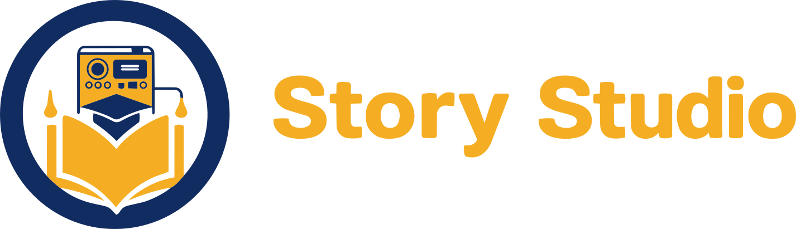

Un moderno editor desktop per creare, unire, provare e generare audiolibri compatibili con Lunii.

  
  
  
  
  
  
  

## Vuoi creare storie per La mia Fabbrica delle Storie?

La [documentazione online](https://hugs11.github.io/story-studio/docs/) è attualmente disponibile in francese.

Story Studio permette di creare e modificare audiolibri per **La mia Fabbrica delle Storie di Lunii**. Include strumenti per l'audio e le immagini, così puoi realizzare un audiolibro senza passare da Audacity ad altri programmi. Tutto rimane in locale: immagini, audio, navigazione, simulazione e generazione dello ZIP.

Due editor adattano l'area di lavoro al progetto:

- l'**Editor a menu** organizza cartelle e storie in un semplice albero;
- l'**Editor a grafo** mostra Schermate, liste di scelte e connessioni per storie a bivi, quiz e percorsi che si incrociano. [Leggi la guida in francese](https://hugs11.github.io/story-studio/docs/editeur-graphe/).

Per una storia singola, l'**Editor semplificato** offre un punto di partenza più guidato. Importa i media, assembla e taglia l'audio, ritaglia le immagini, organizza menu e percorsi e genera uno ZIP compatibile con Lunii.

> Story Studio è uno strumento della community. Non è affiliato, approvato o sponsorizzato da Lunii.

> **Story Studio è progettato e sviluppato con l'aiuto di strumenti di intelligenza artificiale. Le decisioni progettuali, la direzione del progetto e la convalida finale restano affidate a persone.**

## Stato beta

Story Studio è in beta: è utilizzabile, ma può ancora presentare bug, casi particolari e problemi di compatibilità con alcuni audiolibri della community. Conserva copie di sicurezza dei progetti importanti e segnala i problemi riproducibili tramite le issue di GitHub.

> ### Unisciti alla community su Discord
>
> Hai un'idea, un bug da discutere, vuoi accedere alle versioni beta o hai bisogno di aiuto? [Unisciti al server Discord di Story Studio](https://discord.gg/jeC6Qk4NS) per parlare con chi usa e sviluppa il progetto.

## Usare Story Studio con la tua Lunii

La scrittura sul dispositivo (invio, eliminazione, riordino e recupero di audiolibri) è stata testata su una **Lunii V3 con firmware 3.1.5 e 3.3.4**, su Windows, Linux e macOS. Altri modelli e versioni del firmware non sono stati verificati su un dispositivo reale, e un aggiornamento del firmware può cambiare il modo in cui il dispositivo memorizza gli audiolibri.

- Fai un backup della Lunii prima della prima scrittura e conserva copie dei tuoi audiolibri.
- Gli audiolibri ufficiali Lunii non vengono mai copiati sul tuo computer.
- Story Studio è fornito "così com'è", senza alcuna garanzia (vedi la [licenza](LICENSE)). **Lo usi con il tuo dispositivo a tuo rischio**: gli autori non possono essere ritenuti responsabili di perdite di dati o malfunzionamenti del dispositivo.

## Versione 0.9.11

Questa versione serve soprattutto a rendere Story Studio più affidabile. Quando la Lunii è occupata, le operazioni aspettano il loro turno invece di essere rifiutate. Un suono troppo debole viene segnalato quando lo aggiungi. Se vuoi, Story Studio può anche avvisarti quando esce una nuova versione.

Dalla 0.9.10, Story Studio ha un catalogo locale e gestisce direttamente la Lunii. Puoi consultare, inviare e recuperare audiolibri, gestire la lista del dispositivo ed espellerlo. Titoli e copertine ufficiali sono facoltativi e richiedono il tuo consenso.

L’interfaccia è disponibile in francese, inglese e italiano. Le traduzioni inglesi e italiane sono prodotte e riviste con IA; le correzioni sono benvenute. In un’installazione esistente senza preferenza di lingua, l’interfaccia rimane in francese; puoi cambiarla nelle Preferenze. Una nuova installazione usa la lingua del sistema se disponibile, altrimenti l’inglese.

- [Scarica l’ultima versione pubblica](https://github.com/Hugs11/story-studio/releases/latest)
- [Consulta il changelog completo](CHANGELOG.md)

## Audiolibri dimostrativi

Scopri Story Studio con due audiolibri pronti da aprire, esplorare nel simulatore e modificare nell'editor:

<table>
  <tr>
    <td align="center" width="50%">
      <a href="https://drive.proton.me/urls/5ND49D487R#IxRa3Bd0Lm8L">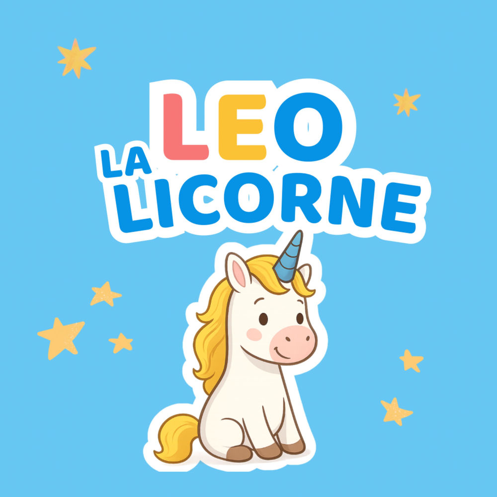</a> 
      <strong>Léo la licorne</strong> 
      <a href="https://drive.proton.me/urls/5ND49D487R#IxRa3Bd0Lm8L">Scarica da Proton Drive</a>
    </td>
    <td align="center" width="50%">
      <a href="https://drive.proton.me/urls/H7ZTBC8S14#aj2WBn39jDRF">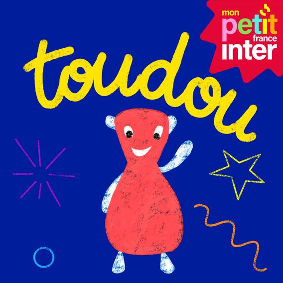</a> 
      <strong>Toudou mon doudou + Cache-Cache — raccolta completa</strong> 
      <a href="https://drive.proton.me/urls/H7ZTBC8S14#aj2WBn39jDRF">Scarica da Proton Drive</a>
    </td>
  </tr>
</table>

Per esplorare un audiolibro:

1. Scarica il file ZIP da Proton Drive.
2. Avvia Story Studio e seleziona **Modifica un audiolibro esistente**.
3. Seleziona il file `.zip` scaricato.

Gli audiolibri sono distribuiti separatamente dal software. Storie, audio e illustrazioni non sono coperti dalla licenza MIT di Story Studio.

## In breve

| | |
|---|---|
| **Stato** | Beta |
| **Piattaforme** | Windows x64, Linux x86_64 e macOS Apple Silicon |
| **Lingue dell'interfaccia** | Francese, inglese e italiano |
| **Formato del progetto** | `.mbah` |
| **Formato di generazione** | ZIP compatibili con Lunii |
| **Stack principale** | React 19, Vite, Tauri 2, Rust |
| **Flusso di lavoro** | Procedure guidate iniziali, Editor a menu, Editor a grafo, unione di ZIP, Media, simulatore e generazione ZIP controllata |
| **Privacy** | Applicazione locale, nessun backend ospitato, nessuna telemetria |

## Dalla prima importazione all'audiolibro pronto

Story Studio riunisce il percorso in un'applicazione locale: parti dai tuoi file o da un audiolibro esistente, prepara i media, costruisci la navigazione, prova il risultato e genera un audiolibro per la Lunii.

### 1. Avvia un progetto o importa storie esistenti

Crea un progetto, riapri un lavoro salvato, modifica uno ZIP/7z esistente oppure parti da un podcast o da YouTube. Le procedure guidate permettono anche di unire più audiolibri o esaminarne uno della community.

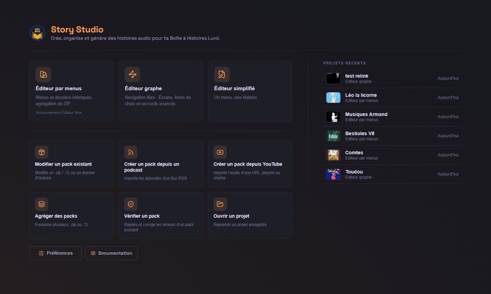

### 2. Gestisci la tua collezione e trasferisci gli audiolibri sulla tua Lunii

Aggiungi le cartelle sorgente, consulta gli audiolibri in griglia o in elenco e
organizza preferiti ed etichette. Collega la Lunii per consultare le sue storie,
inviare audiolibri, recuperarli nel catalogo ed espellere il dispositivo in sicurezza.

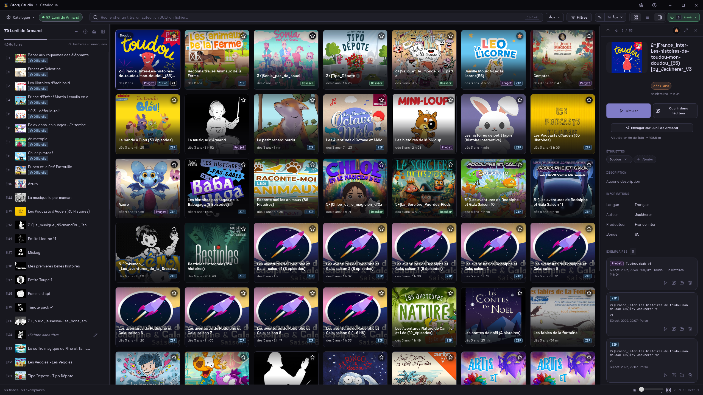

Vedi anche il catalogo in elenco

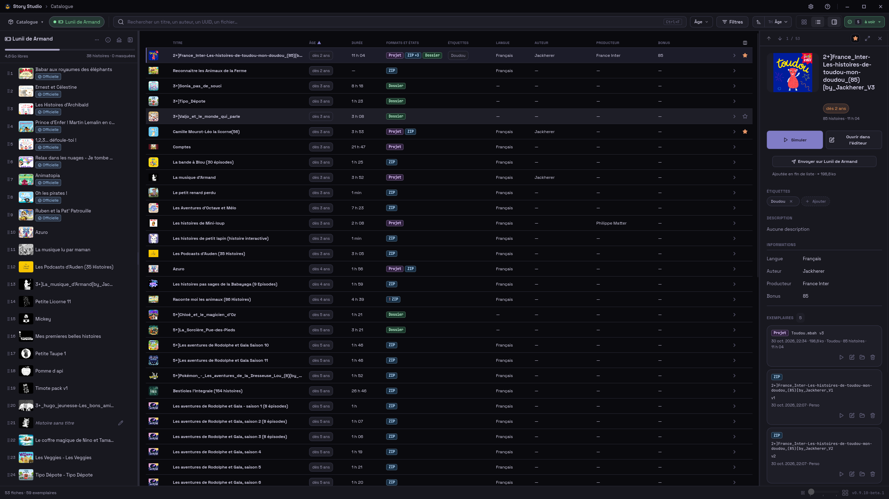

### 3. Prepara l'audio

Importa o registra l'audio e modificalo prima di usarlo. Puoi dividere una lunga registrazione in clip riutilizzabili oppure riordinare e assemblare più file in una traccia senza modificare gli originali.

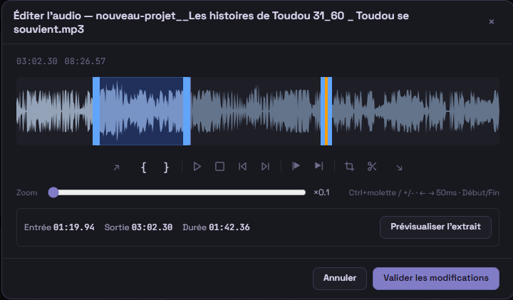

| Dividi una registrazione in clip | Assembla più file in una traccia |
|---|---|
| 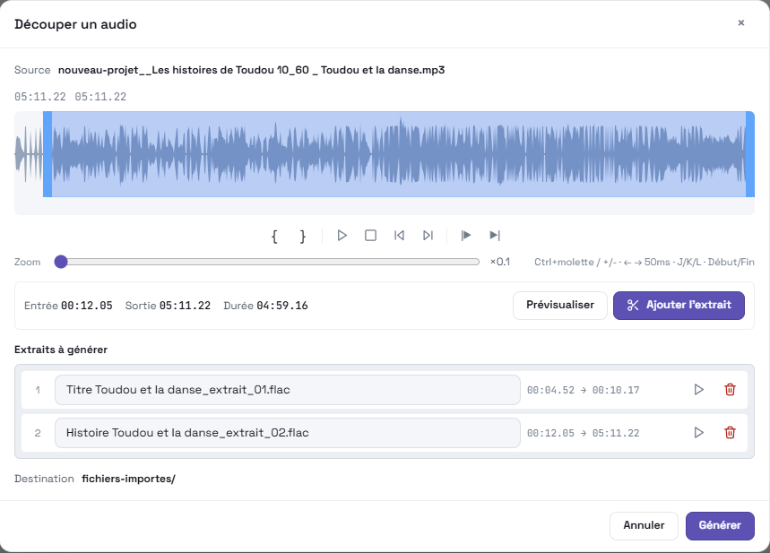 | 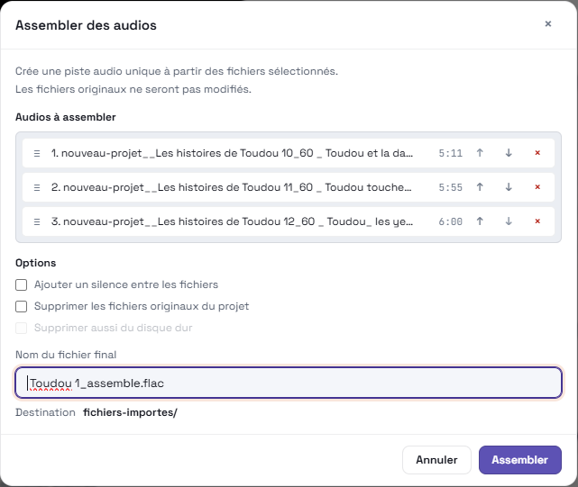 |

### 4. Crea voci, genera illustrazioni e adatta immagini

Genera voci localmente con Piper, pronto all'uso, oppure usa XTTS per la clonazione vocale avanzata. ComfyUI produce illustrazioni tramite un servizio locale; puoi seguire le attività vocali e visive nelle code di generazione di Story Studio.

| Genera una voce con Piper o XTTS | Genera un'illustrazione con ComfyUI |
|---|---|
| 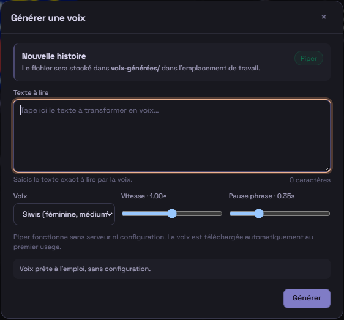 | 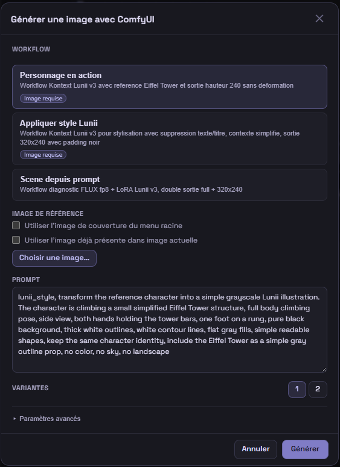 |

Puoi ritagliare, ridimensionare e regolare le immagini per il formato 320×240 della Lunii.

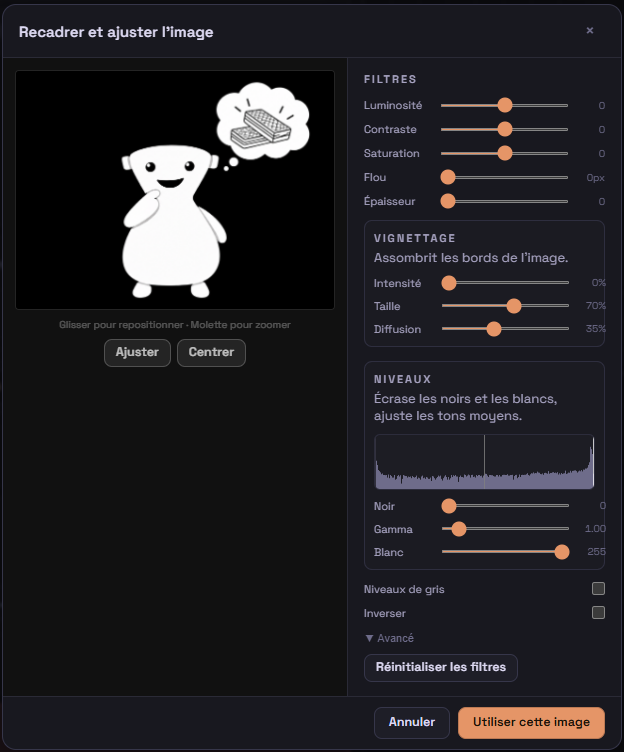

### 5. Costruisci e prova la navigazione

Con l'**Editor a menu**, costruisci un albero di cartelle e storie, assegna immagini e audio e definisci il comportamento dei tasti durante e dopo la riproduzione. Il Diagramma mostra il percorso mantenendo l'organizzazione per livelli.

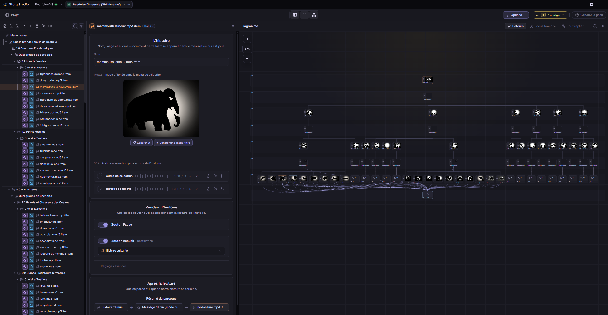

Con l'**Editor a grafo**, lavora direttamente su Schermate, liste di scelte e connessioni. Puoi creare storie a bivi, quiz, selezioni casuali e percorsi che riutilizzano le stesse Schermate in più punti.

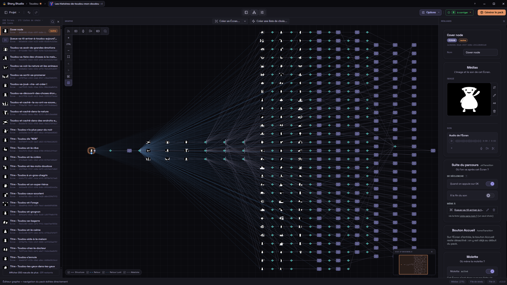

I due editor condividono Media, strumenti audio, coda di generazione e simulatore flottante. Puoi provare la navigazione come sulla Lunii prima di generare lo ZIP.

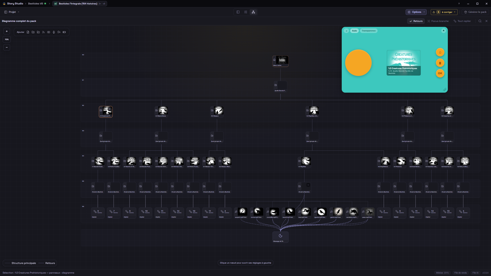

### 6. Controlla le impostazioni e genera lo ZIP

Controlla metadati pubblici, Miniatura del catalogo, nome del file e impostazioni audio e di navigazione. Story Studio verifica struttura, identità e media, poi rilegge lo ZIP prodotto prima di completare la generazione.

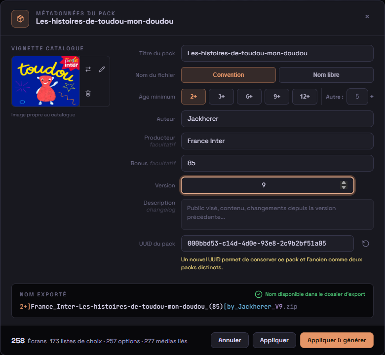

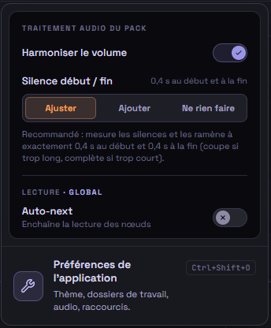

Puoi anche analizzare separatamente gli audiolibri della community. Lo strumento raggruppa i problemi di struttura, immagini e audio, propone correzioni sicure ed esporta un rapporto dettagliato.

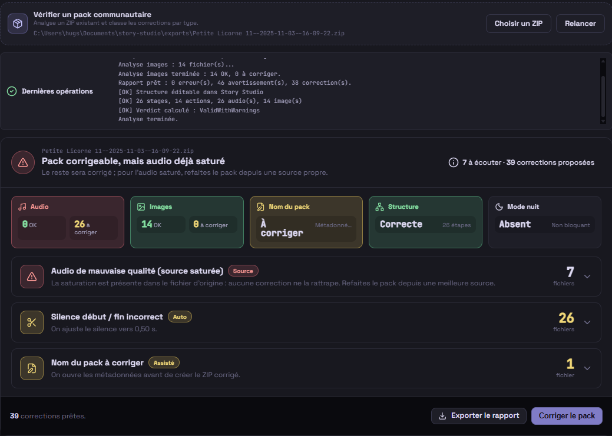

## Funzionalità

- **Catalogo & Lunii**: organizza gli audiolibri locali, collega la Lunii, invia e recupera audiolibri e gestisci la sua lista.
- **Editor a menu** con cartelle, storie, menu annidati, selezione multipla, trascinamento e Diagramma.
- **Editor a grafo** con Schermate, liste di scelte, connessioni, selezione multipla, appunti e disposizione automatica.
- **Procedure guidate iniziali** per modificare un audiolibro, creare da podcast o YouTube, unire ZIP e verificare o correggere un audiolibro della community.
- **Importazione di ZIP Lunii**: scelta dell'editor quando possibile, apertura nel grafo delle strutture complesse e scelta di un audiolibro negli archivi che ne contengono diversi.
- **Strumenti audio integrati**: registrazione dal microfono, ritaglio, tagli, dissolvenze, assemblaggio e inserimento di silenzio.
- **Strumenti immagine integrati**: ritaglio automatico a 320×240 e generazione di immagini con testo dai nomi dei nodi.
- **Sintesi vocale locale** con Piper predefinito e XTTS come opzione avanzata.
- **Media** con tag, filtri, contatori di utilizzo e anteprime rapide.
- **Simulatore integrato** per provare navigazione e nodi finali prima della generazione ZIP.
- **Convalida e coda di generazione**: controlli di compatibilità e generazione in serie con registro.
- **Integrazioni locali facoltative**: YouTube tramite yt-dlp, XTTS per la voce e ComfyUI per le immagini.
- **Gestione del progetto**: sessioni senza salvataggio obbligatorio, salvataggio automatico, istantanee di recupero, versioni di sicurezza, scorciatoie configurabili, temi chiaro e scuro e vista Diagramma completa.

## Perché Story Studio?

Cercavo uno strumento semplice per creare storie audio per mio figlio. Da ex montatore video, non trovavo negli strumenti esistenti ciò che ritenevo essenziale: un'interfaccia visiva e diretta per costruire una narrazione in modo fluido, senza riga di comando o strutture di cartelle complesse.

Story Studio nasce da questa esigenza: riunire importazione, immagini, audio, navigazione, simulazione e generazione ZIP in un'unica area di lavoro locale e chiara.

## Requisiti

| Piattaforma | Requisiti e limiti |
|---|---|
| Windows x64 | Windows 10 o successivo con WebView2 |
| Linux x86_64 | Distribuzione basata su glibc con WebKitGTK 4.1 e i consueti codec GStreamer; disponibili pacchetti AppImage, DEB e RPM |
| macOS Apple Silicon | macOS 11 o successivo su Mac M1 o successivo; i Mac Intel non sono supportati |

I binari di terze parti mantengono le rispettive licenze e una provenienza fissata: vedi [THIRD_PARTY_NOTICES.md](THIRD_PARTY_NOTICES.md) e [l'offerta del codice sorgente corrispondente](THIRD_PARTY_SOURCE_OFFER.md).

## Installazione

Scarica il pacchetto per la tua piattaforma dalla [pagina GitHub Releases](https://github.com/Hugs11/story-studio/releases/latest):

- **Windows x64:** usa il programma EXE o il pacchetto MSI per distribuzioni gestite.
- **AppImage:** rendi eseguibile il file con `chmod +x Story-Studio*.AppImage`, poi avvialo.
- **Debian/Ubuntu:** installa il DEB con `sudo apt install ./Story-Studio*.deb`.
- **Fedora:** installa l'RPM con `sudo dnf install ./Story-Studio*.rpm`.
- **macOS Apple Silicon:** apri il DMG, trascina Story Studio in Applicazioni e avvia l'app.

La build macOS non ha un certificato Developer ID e non è autenticata da Apple. Gatekeeper può bloccare il primo avvio. Nel Finder fai Control-clic sull'app e scegli **Apri**, oppure usa **Impostazioni di Sistema → Privacy e Sicurezza → Apri comunque**. Non disattivare Gatekeeper globalmente.

Le integrazioni IA sono facoltative. XTTS è stato provato su Linux in modalità CPU; la modalità GPU non è stata convalidata per la 0.9.9. ComfyUI è stato convalidato manualmente solo su Windows; i test manuali Linux non sono stati eseguiti.

Per compilare dai sorgenti o contribuire, consulta [CONTRIBUTING.md](CONTRIBUTING.md).

## File di progetto e area di lavoro

Story Studio salva i progetti come file `.mbah`. Le risorse sono organizzate in cartelle di lavoro gestite:

| Cartella | Scopo |
|---|---|
| `fichiers-importes/` | Media importati quando è attiva la copia all'importazione |
| `enregistrements/` | Registrazioni dal microfono |
| `voix-generees/` | Clip vocali generate da XTTS |
| `images-generees/` | Immagini generate da ComfyUI e immagini modificate |
| `zips-extraits/` | Raccolte ZIP estratte |
| `sauvegardes/` | Cartella predefinita di salvataggio e versioni di sicurezza |
| `exports/` | Cartella suggerita per gli audiolibri generati |

I file nelle cartelle media gestite usano il prefisso `{project-name}__` per condividere più tranquillamente l'area di lavoro tra progetti.

I dati dell'applicazione si trovano in `%LOCALAPPDATA%\com.hugs11.story-studio` su Windows, `${XDG_DATA_HOME:-~/.local/share}/com.hugs11.story-studio` su Linux e `~/Library/Application Support/com.hugs11.story-studio` su macOS. I file scelti dall'utente restano accessibili anche fuori da queste cartelle, compresi i volumi macOS esterni sotto `/Volumes`.

Quando Story Studio propone di eliminare media dal disco, elimina solo i file nelle cartelle media gestite. I file altrove vengono rimossi solo dal progetto o da Media e mai dal disco.

## Documentazione

- [Documentazione utente online](https://hugs11.github.io/story-studio/docs/) — in francese
- [Voci locali Piper e XTTS](https://hugs11.github.io/story-studio/docs/voix-locales-piper-xtts/) — in francese
- [Integrazione ComfyUI](https://hugs11.github.io/story-studio/docs/comfyui/) — in francese
- [Modello di sicurezza](SECURITY.md)
- [Note sulle terze parti](THIRD_PARTY_NOTICES.md)
- [Changelog](CHANGELOG.md)

Il modello di sicurezza, le note sulle terze parti e il changelog sono attualmente disponibili solo in inglese.

## Roadmap

- Correggere i bug rimanenti.
- Uscire dalla beta con una versione 1 definitiva.
- Rendere l’app compatibile con altri dispositivi per storie.

## Contribuire

Sono benvenuti in particolare:

- Segnalazioni di bug riproducibili.
- Note di compatibilità sugli audiolibri della community.
- Miglioramenti alla documentazione.
- Per correggere una traduzione su GitHub, apri una issue o proponi una pull request: vedi [TRANSLATING.md](TRANSLATING.md).
- Pull request mirate con note di test chiare.

Per discutere un'idea o condividere un riscontro sulla beta, unisciti al [server Discord di Story Studio](https://discord.gg/jeC6Qk4NS). Leggi [CONTRIBUTING.md](CONTRIBUTING.md) prima di aprire una pull request.

## Sicurezza

Story Studio è un editor desktop locale. Le funzionalità facoltative XTTS e ComfyUI si collegano a servizi locali configurati dall'utente.

Consulta [SECURITY.md](SECURITY.md) per il modello dei permessi e la procedura di segnalazione delle vulnerabilità.

## Licenza

Il codice sorgente di Story Studio è distribuito sotto [licenza MIT](LICENSE). I binari e le risorse di terze parti conservano le rispettive licenze: vedi [THIRD_PARTY_NOTICES.md](THIRD_PARTY_NOTICES.md).
